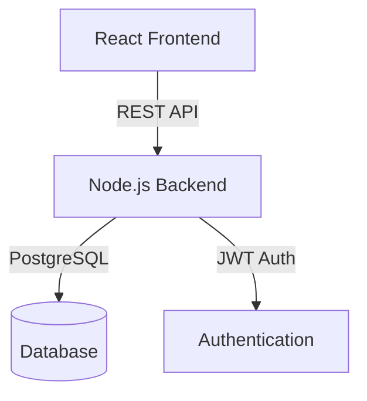
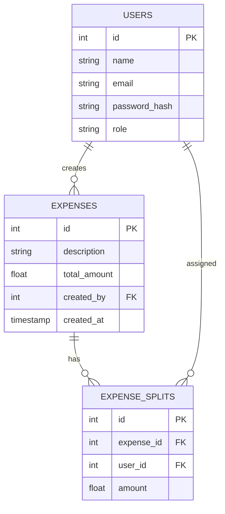

# Expense Management Application – High Level Design (HLD)

## 1. Overview

The Expense Management Application is a web-based system that allows users to manage and split expenses with others. Users can log in, manage their profile, create/update/delete expenses, and split expenses either equally or by custom amounts. A super admin user can add new users to the system.

---

## 2. Technology Stack

- **Frontend:** React.js
- **Backend:** Node.js (Express)
- **Authentication:** JWT Token-based
- **Database:** PostgreSQL

---

## 3. Architecture

---

## 4. Core Modules

### 4.1 Frontend (React.js)
- **Login Page:** User authentication.
- **User Profile Page:** View and update profile.
- **Manage Expenses Page:** List, create, update, delete expenses; split expenses (equal/custom).
- **Admin Panel:** (Super admin only) Add new users.

### 4.2 Backend (Node.js + Express)
- **Auth Module:** JWT-based authentication, login, and token validation.
- **User Module:** CRUD for users (super admin can add users).
- **Expense Module:** CRUD for expenses, split logic, and assignment.
- **Split Logic:** Handles both equal and custom splits.

### 4.3 Database (PostgreSQL)
- **Users Table:** Stores user info, roles (user/super admin).
- **Expenses Table:** Stores expense records.
- **ExpenseSplits Table:** Stores split details per user per expense.

---

## 5. Entity Relationship Diagram

---

## 6. User Roles

- **Super Admin:** Can add users, view all expenses, manage all users.
- **User:** Can manage own expenses, view their splits.

---

## 7. API Endpoints (Sample)

### 7.1 Auth
- `POST /api/login` – User login
- `POST /api/logout` – User logout

### 7.2 Users
- `POST /api/users` – Add user (Super admin only)
- `GET /api/users/me` – Get own profile
- `PUT /api/users/me` – Update own profile

### 7.3 Expenses
- `GET /api/expenses` – List expenses
- `POST /api/expenses` – Create expense
- `PUT /api/expenses/:id` – Update expense
- `DELETE /api/expenses/:id` – Delete expense

### 7.4 Splits
- `POST /api/expenses/:id/split` – Split expense (equal/custom)

---

## 8. Expense Split Logic

- **Equal Split:** If not set, divide total by number of users.
- **Custom Split:** User can assign specific amounts to each user.
- **Validation:** Total split must equal expense amount.

**Example:**
- Expense = 500, Users = 2 → Each sees 250 by default.
- User 1 sets 300, User 2 gets 200.

---

## 9. Authentication & Authorization

- JWT tokens for session management.
- Middleware to protect routes.
- Role-based access for admin/user.

---

## 10. Security

- Passwords hashed (bcrypt).
- JWT tokens stored securely.
- Input validation on all endpoints.

---

## 11. Frontend Pages

- **Login**
- **Profile**
- **Expense Management**
- **Admin (User Management)**

---

## 12. User Flow

1. **Super Admin** logs in and adds users.
2. **Users** log in, manage their profile, and create expenses.
3. **Users** split expenses (equal or custom).
4. **Users** can view, update, or delete their expenses. 